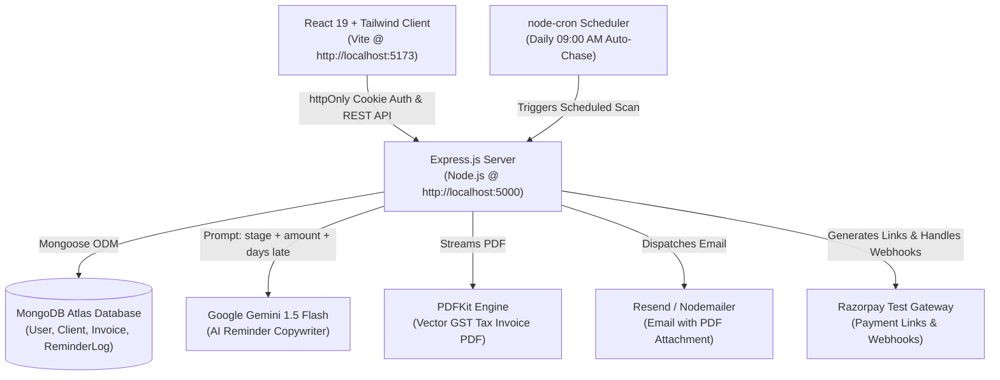

# ⚡ ChasePay — Invoicing & AI Payment Reminders for Indian Freelancers

> **GST-ready invoices and automated AI-written polite-to-firm payment reminders that get freelancers paid on time.**

[](https://nodejs.org/)
[](https://react.dev/)
[](https://tailwindcss.com/)
[](https://www.mongodb.com/)
[](LICENSE)

---

## 📌 Problem

Indian freelancers and independent agencies face two persistent challenges:
1. **GST Compliance Overhead**: Manually calculating line-item GST rates (0%, 5%, 12%, 18%, 28%), applying SAC/HSN codes, computing taxable amounts vs total, and maintaining proper invoice numbering is tedious and error-prone.
2. **Awkward Payment Follow-ups**: Over 68% of Indian freelance invoices are delayed past their due date. Following up manually feels uncomfortable, damages client relationships, and consumes hours of billable creative time.

---

## 💡 Solution

**ChasePay** automates the entire billing and collection lifecycle:
- **Server-Verified GST Calculations**: Line-item rates, subtotal, discount, and GST computed exclusively on the server with integer-precision paise.
- **Auto-Generated Invoice Numbers**: Format `INV-YYYY-0001` auto-sequenced per user, per calendar year.
- **PDFKit GST Tax Invoices**: Pixel-perfect PDF bills generated on-the-fly with freelancer GSTIN, client billing details, tax tables, and direct payment links.
- **Google Gemini AI Auto-Reminders**: Automatically detects invoices due in 3 days, due today, 3 days late, or 7+ days late. Drafts human-like reminders transitioning dynamically from **courteous heads-up** to **firm escalation**.
- **Razorpay Payment Links & Webhooks**: Generates instant checkout URLs with automatic signature verification on payment capture.
- **Zero-Setup Database Fallback**: Built-in in-memory MongoDB fallback for instant local evaluation without installing MongoDB daemons.

---

## 🏛️ System Architecture



---

## ✨ Features

| Feature | Description |
|---|---|
| **Paise-Level Precision** | All monetary amounts stored as integers in paise to eliminate IEEE-754 floating-point inaccuracies. |
| **GST Tax Invoicing** | Supports 0%, 5%, 12%, 18%, and 28% GST brackets with auto-tax total and grand total computation. |
| **Automated AI Copywriting** | Uses Google Gemini with tone progression: **pre-due** (friendly), **due** (polite), **overdue-1** (direct), **overdue-2** (urgent). |
| **Instant Template Fallback** | Instant fallback to structured templates if Gemini API keys are omitted or rate-limited. |
| **Daily 9:00 AM Cron** | Node-cron schedule checks active invoices daily; manual trigger via `POST /api/reminders/run` or UI button. |
| **Razorpay Payment Links** | Auto-generates payment links on invoice dispatch; verifies HMAC SHA-256 webhook signatures idempotently. |
| **Public Client Portal** | Dedicated `/i/:publicId` route where clients can view invoices and click to pay without creating an account. |
| **First-View Tracking** | Automatically marks invoice status from `sent` → `viewed` the moment the client opens their public link. |
| **Security & Validation** | Zod input validation on all payloads, bcrypt password hashing, and secure httpOnly JWT cookies. |

---

## 📂 Project Structure

```
End-Term Mern/
├── client/                      # React (Vite) Frontend
│   ├── src/
│   │   ├── api/axios.js         # Pre-configured Axios instance withCredentials
│   │   ├── context/AuthContext  # User auth, login, register, profile
│   │   ├── components/          # Layout, StatusBadge, ProtectedRoute
│   │   ├── pages/
│   │   │   ├── Login.jsx        # Sign in form
│   │   │   ├── Register.jsx     # Registration form
│   │   │   ├── Dashboard.jsx    # 3 Metric cards + Recent invoices + Run Reminders
│   │   │   ├── Invoices.jsx     # Status tabs (All, Draft, Sent, Viewed, Paid, Overdue)
│   │   │   ├── InvoiceBuilder   # Add/remove items, live GST preview, due dates
│   │   │   ├── InvoiceDetail    # Tax invoice view, Download PDF, Send, Timeline
│   │   │   ├── Clients.jsx      # Client directory, GSTIN records, add/edit modal
│   │   │   ├── Settings.jsx     # Business name, GSTIN, Address, UPI ID
│   │   │   ├── Pricing.jsx      # Free vs Pro tier comparison table
│   │   │   └── PublicInvoice    # Client-facing portal at /i/:publicId
│   │   └── utils/formatters.js  # formatPaise (₹), formatDate helpers
│   ├── .env.example
│   └── package.json
│
└── server/                      # Express Backend
    ├── src/
    │   ├── config/db.js         # Atlas connection with zero-setup memory fallback
    │   ├── models/              # User, Client, Invoice, ReminderLog
    │   ├── middleware/          # auth (protect), validate (Zod), errorHandler
    │   ├── controllers/         # auth, client, invoice, dashboard, reminder, webhook
    │   ├── routes/              # /api/auth, /api/clients, /api/invoices, etc.
    │   ├── services/
    │   │   ├── pdfService.js    # PDFKit invoice vector generation
    │   │   ├── emailService.js  # Resend, SMTP & Mock email delivery
    │   │   ├── razorpayService  # Razorpay payment links & HMAC verification
    │   │   ├── aiService.js     # Gemini AI prompt engine & template fallbacks
    │   │   └── reminderService  # Reminder schedule evaluator & overdue marker
    │   ├── jobs/reminderCron.js # node-cron 9:00 AM daily scheduler
    │   ├── seed.js              # One-command demo seeder (demo user + 8 invoices)
    │   └── index.js             # Express app entry point
    ├── test-phase1.js           # Auth & foundation test suite
    ├── test-phase2.js           # Clients, Invoices & stats test suite
    ├── test-phase4.js           # PDF generation & public portal test suite
    ├── test-phase5.js           # Razorpay, Webhooks & AI reminders test suite
    ├── .env.example
    └── package.json
```

---

## 🚀 Quickstart & Setup

### Prerequisites
- [Node.js](https://nodejs.org/) v18+ installed
- Git

### 1. Clone & Configure Environment

#### Server Configuration (`server/.env`):
```ini
PORT=5000
MONGO_URI=mongodb+srv://<username>:<password>@cluster0.xxxxx.mongodb.net/chasepay?retryWrites=true&w=majority
JWT_SECRET=your_super_secret_jwt_key_here
JWT_EXPIRES_IN=7d
CLIENT_URL=http://localhost:5173

# Optional: Add your Resend key for live email dispatch (defaults to mock log in dev)
RESEND_API_KEY=

# Optional: Add your Razorpay test keys (defaults to demo links in dev)
RAZORPAY_KEY_ID=
RAZORPAY_KEY_SECRET=
RAZORPAY_WEBHOOK_SECRET=

# Optional: Add Google Gemini key (defaults to dynamic polite-to-firm templates in dev)
GEMINI_API_KEY=
```

#### Client Configuration (`client/.env`):
```ini
VITE_API_URL=http://localhost:5000/api
```

---

### 2. Install Dependencies

```powershell
# Install backend packages
cd server
npm install

# Install frontend packages
cd ../client
npm install
```

---

### 3. Seed Demo Data

Run the database seeder to create a complete demo user, 4 clients, and 8 invoices across all statuses (`paid`, `viewed`, `sent`, `overdue`, `draft`):

```powershell
cd server
npm run seed
```

**Pre-seeded Demo Credentials:**
- **Email**: `demo@chasepay.in`
- **Password**: `password123`

---

### 4. Run Development Servers

**Terminal 1 — Backend:**
```powershell
cd server
npm run dev
```
*Server boots on `http://localhost:5000` and automatically connects to your MongoDB Atlas cluster (or in-memory DB).*

**Terminal 2 — Frontend:**
```powershell
cd client
npm run dev
```
*Vite client boots on `http://localhost:5173`.*

---

## 🧪 Automated Testing Suites

Each milestone contains an isolated, self-contained test suite that can be run with single commands:

```powershell
cd server
npm run test:phase1    # Auth cycle, cookies, password hashing & Zod checks
npm run test:phase2    # Client scoping, server totals & auto-increment invoice numbers
npm run test:phase4    # PDFKit binary generation, email dispatch & public view tracking
npm run test:phase5    # Razorpay link creation, HMAC webhook & Gemini reminder stages
```

---

## 📬 API Reference Summary

| Method | Endpoint | Auth | Description |
|---|---|:---:|---|
| `POST` | `/api/auth/register` | No | Register new user; sets httpOnly cookie |
| `POST` | `/api/auth/login` | No | Login user; sets httpOnly cookie |
| `POST` | `/api/auth/logout` | Yes | Clears session cookie |
| `GET` | `/api/auth/me` | Yes | Current authenticated user profile |
| `PUT` | `/api/auth/profile` | Yes | Update business name, address, GSTIN, UPI ID |
| `GET` | `/api/clients` | Yes | List clients scoped to current user |
| `POST` | `/api/clients` | Yes | Create new client with GSTIN |
| `GET` | `/api/invoices` | Yes | List invoices (supports `?status=` filter) |
| `POST` | `/api/invoices` | Yes | Create invoice with server-computed totals |
| `GET` | `/api/invoices/:id/pdf` | Yes | Generate & stream PDF invoice |
| `POST` | `/api/invoices/:id/send` | Yes | Create payment link, email client & set `sent` |
| `GET` | `/api/public/invoices/:publicId` | No | Public client portal; marks `viewed` |
| `POST` | `/api/reminders/run` | Yes | Manually trigger reminder scan |
| `GET` | `/api/reminders/invoices/:id` | Yes | Fetch reminder log history for invoice |
| `POST` | `/api/webhooks/razorpay` | No | Razorpay webhook; marks invoice `paid` |
| `GET` | `/api/dashboard/stats` | Yes | Aggregated outstanding, overdue & monthly paid |

---

## 🖼️ User Interface Showcase

| Page | Description |
|---|---|
| **Dashboard** | 3 Metric cards (Total Outstanding, Overdue Amount, Paid this Month), Setup banner, Recent invoices, and "Run Reminders Now" trigger. |
| **Invoice Builder** | Dynamic line items, live totals preview, GST rate selector (0/5/12/18/28%), and notes. |
| **Invoice Detail** | Tax invoice layout preview, Download PDF, Send to Client, Razorpay checkout banner, and AI reminder history timeline. |
| **Clients** | Searchable client card grid, contact details, GSTIN tags, and create/edit modal. |
| **Settings** | Business details configuration: Trade Name, Registered Address, GSTIN, and direct UPI ID. |
| **Public Portal** | Client invoice review page at `/i/:publicId` with instant **Pay Now** CTA. |

---

## 🔮 Future Roadmap

- [ ] **WhatsApp Business Reminders**: Integrate Twilio / Gupshup WhatsApp API for payment reminders directly inside WhatsApp.
- [ ] **E-Invoicing API**: Direct integration with the Indian GST Portal (IRN & QR code generation for B2B invoices > threshold).
- [ ] **Multi-Currency Support**: Support international client invoicing in USD, EUR, and GBP with auto conversion to INR.
- [ ] **Recurring Subscriptions**: Automatic monthly recurring retainer invoicing for long-term clients.

---

## 📄 License
This project is open-source and available under the [MIT License](LICENSE).
